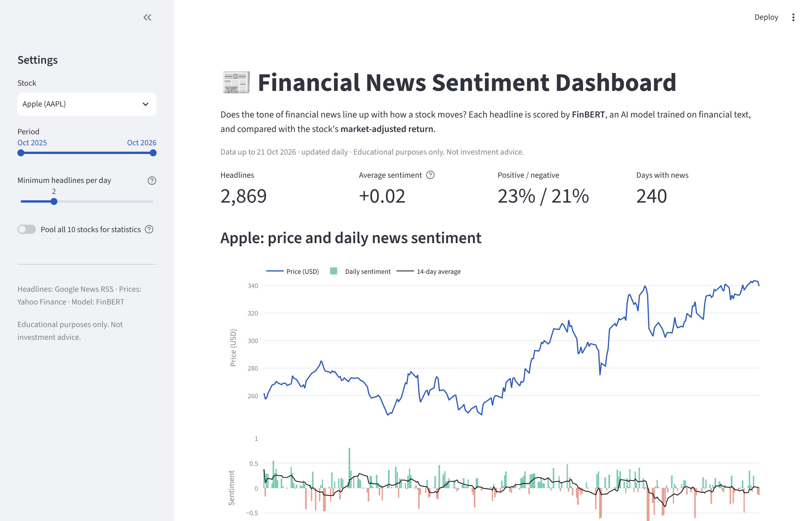

# 📰 Panel de análisis de sentimiento financiero

¿El tono de las noticias financieras coincide con el movimiento de una acción?
Esta herramienta evalúa titulares con **FinBERT**, un modelo de lenguaje entrenado con textos financieros, y compara el sentimiento diario con los **rendimientos ajustados por mercado** de diez empresas grandes. Los titulares nuevos se recogen y evalúan de forma automática cada día bursátil.

La interfaz está en español de Colombia. El análisis —FinBERT, rendimientos, correlaciones de Pearson y Spearman, y la automatización— es el del proyecto original.

**[▶ Demostración original (en inglés)](https://news-sentiment-dashboard-787.streamlit.app)** · no requiere instalación y se abre en el navegador



La imagen corresponde a la interfaz original en inglés. Esta copia muestra los mismos gráficos y tablas, con los textos en español.

> Solo con fines educativos. No constituye una recomendación de inversión.

---

## Qué muestra

- **Precio y sentimiento:** el precio de la acción arriba y el sentimiento diario de las noticias abajo, con un promedio de 14 días.
- **Estadísticas:** correlación entre el sentimiento y los rendimientos anormales del día anterior, del mismo día y del día siguiente, con valores p y una lectura en español. Se pueden agrupar las diez acciones para disponer de más datos.
- **Grupos de sentimiento:** rendimiento anormal promedio en el tercio de días más negativo, el tercio intermedio y el tercio más positivo.
- **Tabla de titulares:** cada titular con su etiqueta, índice, fuente y enlace.
- **Pruébalo:** escribe un titular y FinBERT lo evalúa en el momento.

Lista de seguimiento (todas cotizan en Estados Unidos): Apple, Microsoft, Nvidia, Amazon, Tesla, JPMorgan, ExxonMobil, Shell, Toyota y Alibaba. Referencia de mercado: SPY (ETF del S&P 500). Los precios se muestran en USD.

## Funcionamiento

**1. Recolección.** Los titulares provienen de Google News RSS (búsqueda `"<Empresa>" stock`). Solo se conservan los que mencionan a la empresa y se eliminan los duplicados sindicados. El historial se reconstruyó semana a semana; desde entonces, un flujo de GitHub Actions agrega titulares nuevos cada día hábil, después del cierre en Estados Unidos.

**2. Evaluación.** FinBERT ([ProsusAI/finbert](https://huggingface.co/ProsusAI/finbert)) devuelve tres probabilidades por titular. Un solo índice las combina:

$$\text{índice} = P(\text{positive}) - P(\text{negative}) \qquad \in [-1, 1]$$

En la interfaz, `positive`, `negative` y `neutral` se muestran como positivo, negativo y neutral. Esas etiquetas en inglés se conservan en los datos y en el modelo.

**3. Alineación con días bursátiles.** Una noticia publicada después del cierre de las 16:00 en Nueva York, o en fin de semana o festivo, solo puede influir en el día bursátil siguiente, y allí se asigna. El sentimiento diario es el promedio de los índices de ese día:

$$S_{i,t} = \frac{1}{N_{i,t}} \sum_{k=1}^{N_{i,t}} \text{índice}_k$$

**4. Rendimientos.** Rendimiento simple diario y rendimiento ajustado por mercado (anormal), que retira los movimientos que afectan a todo el mercado:

$$r_{i,t} = \frac{P_{i,t}}{P_{i,t-1}} - 1 \qquad AR_{i,t} = r_{i,t} - r_{\text{SPY},t}$$

**5. Prueba.** Correlación de Pearson y de Spearman entre $S_{i,t}$ y $AR_{i,t-1}$, $AR_{i,t}$ y $AR_{i,t+1}$:

| Horizonte | Pregunta que plantea |
|---|---|
| $t-1$ | ¿La noticia *sigue* a los precios? (la prensa explica el movimiento de ayer) |
| $t$ | ¿La noticia y los precios se mueven *juntos*? |
| $t+1$ | ¿La noticia *anticipa* el rendimiento de mañana? Con eficiencia de mercado, este valor debería estar cerca de cero. |

La correlación describe una asociación estadística. No demuestra causalidad ni constituye una predicción de precios.

## Requisitos

- Python 3.11 (la misma versión que usa la automatización).
- Conexión a internet la primera vez que se evalúa un titular con FinBERT (el modelo pesa unos 440 MB).
- No hacen falta claves de API. El panel de precios, sentimiento y correlaciones funciona con los CSV que ya trae el repositorio.

## Ejecución local

En Windows, desde esta carpeta:

```powershell
python -m venv .venv
.venv\Scripts\activate
pip install -r requirements.txt
streamlit run app.py
```

En macOS o Linux:

```bash
python -m venv .venv && source .venv/bin/activate
pip install -r requirements.txt
streamlit run app.py
```

Otras órdenes útiles, con el entorno activado:

```bash
pytest                        # pruebas de la lógica de análisis
python scripts/collect.py     # opcional: descarga y evalúa las noticias de hoy
```

## Despliegue en Streamlit Community Cloud

1. Publica este repositorio en GitHub y déjalo público. Streamlit Community Cloud no despliega repositorios privados en el plan gratuito.
2. Entra a [share.streamlit.io](https://share.streamlit.io) e inicia sesión con la misma cuenta de GitHub.
3. Elige **Create app**.
4. Selecciona el repositorio, la rama (por lo general `main`) y el archivo principal `app.py`.
5. Streamlit instala `requirements.txt` solo. No hace falta configurar secretos: el archivo `.env.example` documenta un token opcional de Hugging Face, que no es necesario.
6. Al publicar, el panel abre con los datos ya guardados. La primera vez que alguien pulse **Evaluar titular**, el servicio descarga FinBERT.

La [demostración del autor](https://news-sentiment-dashboard-787.streamlit.app) sigue siendo la versión original en inglés.

## Automatización con GitHub Actions

El archivo `.github/workflows/daily.yml` no se modificó.

- Se llama **Daily news collection**.
- Se ejecuta de lunes a viernes a las 22:17 UTC, después del cierre del mercado estadounidense, y también puede lanzarse a mano desde la pestaña Actions.
- El trabajo usa Python 3.11, guarda en caché FinBERT, instala `requirements.txt` y ejecuta `scripts/collect.py`.
- Si hay datos nuevos en `data/`, los confirma y los sube al repositorio. Por eso el flujo pide permiso de escritura sobre el contenido.
- El tiempo máximo del trabajo es 30 minutos.

Esos datos confirmados son los que lee el panel. La traducción de la interfaz no cambia el horario, el script de recolección ni el mensaje de la confirmación.

## Estructura del proyecto

```
├── app.py                      panel de Streamlit
├── src/
│   ├── config.py               lista de seguimiento y parámetros
│   ├── fetch.py                titulares (Google News RSS) y precios (Yahoo Finance)
│   ├── sentiment.py            evaluación con FinBERT
│   ├── analysis.py             días bursátiles, rendimientos y correlaciones
│   └── storage.py              lectura y escritura de los CSV
├── scripts/collect.py          recolección diaria
├── data/                       titulares (un CSV por mes) y precios
├── tests/                      pruebas con datos sintéticos
└── .github/workflows/daily.yml actualización diaria automática
```

## Fuentes de datos

| Dato | Fuente | Notas |
|---|---|---|
| Titulares | Google News RSS | Solo texto del titular, fuente, enlace y hora. Los artículos permanecen en sus medios. |
| Precios | Yahoo Finance mediante `yfinance` | Cierre diario ajustado, en USD |
| Modelo | FinBERT (Araci, 2019), Hugging Face | Licencia Apache 2.0 |

## Limitaciones

- Solo se usan titulares, no los artículos completos. La cobertura de Google News varía según la acción y a lo largo del tiempo.
- Los titulares reconstruidos traen la fecha sin hora exacta, así que alguna noticia posterior al cierre puede quedar en el día equivocado. Los titulares recogidos a diario sí tienen la hora.
- FinBERT malinterpreta algunos titulares: preguntas ("Should you buy...?"), sarcasmo y menciones de paso. Se entrenó con inglés financiero.
- Diez empresas grandes y muy cubiertas no representan todo el mercado. Las empresas de baja capitalización se comportan de otra manera.
- Se calculan varias correlaciones, así que algunas pueden parecer significativas por azar. La correlación no implica causalidad y esto no es una señal de negociación.

## Referencias

- Araci, D. (2019). *FinBERT: Financial Sentiment Analysis with Pre-trained Language Models.* arXiv:1908.10063.
- Tetlock, P. C. (2007). Giving content to investor sentiment: The role of media in the stock market. *Journal of Finance*, 62(3), 1139–1168.
- Fama, E. F. (1970). Efficient capital markets: A review of theory and empirical work. *Journal of Finance*, 25(2), 383–417.

## Reconocimiento

Esta versión adapta al español de Colombia la interfaz del proyecto original, sin reemplazar el modelo ni los cálculos:

**Financial News Sentiment Dashboard**, de Mehedi Hasan Khan — [github.com/KhanFT787/news-sentiment-dashboard](https://github.com/KhanFT787/news-sentiment-dashboard)

Desarrollado por [Mehedi Hasan Khan](https://www.linkedin.com/in/khan787/).

## Licencia

MIT. Consulta [LICENSE](LICENSE).

Copyright (c) 2026 Mehedi Hasan Khan.

Se concede permiso, de forma gratuita, a cualquier persona que obtenga una copia de este software y de los archivos de documentación asociados (el "Software") para usarlo sin restricción, incluidos, entre otros, los derechos de usar, copiar, modificar, fusionar, publicar, distribuir, sublicenciar y/o vender copias del Software, y de permitir a las personas a quienes se les proporcione que hagan lo mismo, con la condición de que el aviso de derechos de autor y este aviso de permiso se incluyan en todas las copias o partes sustanciales del Software.

EL SOFTWARE SE PROPORCIONA "TAL CUAL", SIN GARANTÍA DE NINGÚN TIPO, EXPRESA O IMPLÍCITA, INCLUIDAS, ENTRE OTRAS, LAS GARANTÍAS DE COMERCIABILIDAD, IDONEIDAD PARA UN PROPÓSITO PARTICULAR Y NO INFRACCIÓN. EN NINGÚN CASO LOS AUTORES O LOS TITULARES DE LOS DERECHOS DE AUTOR SERÁN RESPONSABLES POR NINGUNA RECLAMACIÓN, DAÑO U OTRA RESPONSABILIDAD, YA SEA CONTRACTUAL, EXTRACONTRACTUAL O DE OTRO TIPO, QUE SURJA DEL SOFTWARE O DE SU USO.

El texto normativo de la licencia permanece en inglés en [LICENSE](LICENSE). Este resumen no lo sustituye.
